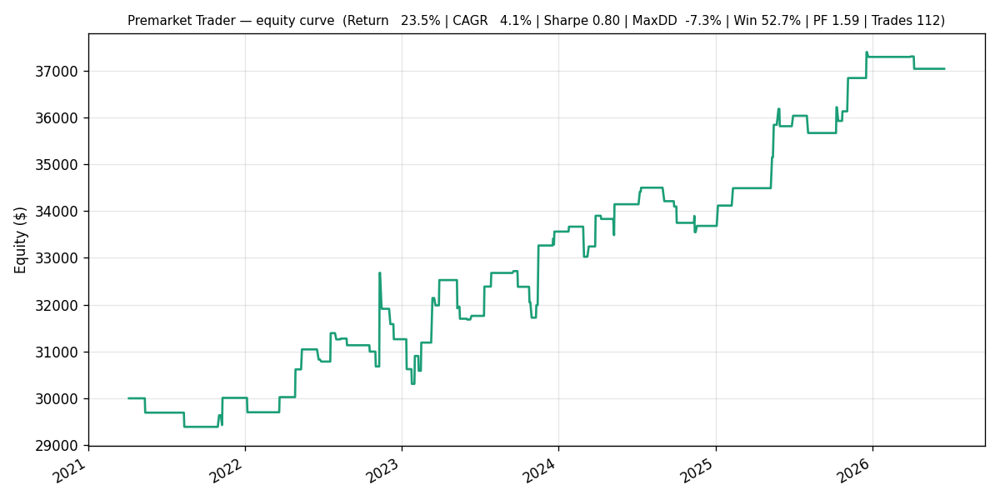

# Premarket Trader

A **premarket-momentum ("gap-and-go") day-trading model** for US equities: it codifies a
classic premarket-momentum playbook into a concrete strategy, **trains a machine-learning
selection model on real market data with walk-forward / out-of-fold validation**, and
ships with an honest backtester and a live-ish scanner.

> ⚠️ **Educational research only — not financial advice.** Day trading is risky and most
> participants lose money. Past backtest performance does not predict future results.

---

## Why it exists

Most "gap-and-go" strategies are taught qualitatively. This project turns that qualitative
playbook (see [docs/PLAYBOOK.md](docs/PLAYBOOK.md)) into something you can **measure**: a
no-lookahead feature pipeline, a trained model, and a leakage-aware backtest that reports
**out-of-sample** numbers and is candid about its limitations.

## Headline result (out-of-sample)

Default ~135-name universe, 2018→present, $30k account, 1% risk/trade, 10 bps slippage/side:

| Variant (out-of-sample TEST) | Return | Sharpe | Max DD | Win rate | Profit factor |
|---|---|---|---|---|---|
| **Rules + ML selection** | **+8.5%** | **1.14** | **−2.8%** | **55.6%** | **1.80** |
| Rules only (naive gap-chase) | −42.4% | −2.16 | −42.4% | 24.6% | 0.40 |

**The trained selection model is the edge:** blindly buying every gap-up loses money out of
sample; the model decides *which* gap-ups are worth trading. The feature set was upgraded
with **corpus-mined, leakage-safe signals** (cross-sectional "leading gainer" rank, prior-bar
candle shape, over-extension, blue-sky) — see [docs/STRATEGY.md §5b](docs/STRATEGY.md#5b-corpus-driven-feature-upgrade-v2)
for the honest v1→v2 comparison and caveats. (Re-run to reproduce — numbers shift with
universe, dates, and data vintage.)



## How it works (one paragraph)

For every `(stock, day)` we build features knowable **at the open** (gap, relative volume,
volatility, recent returns, market breadth, …). A **LightGBM** classifier predicts the
probability the day's trade is profitable, trained **walk-forward** so its predictions are
never in-sample. The strategy buys qualifying names at the open, manages them with a fixed
**2:1 profit-to-loss bracket** (exit by close otherwise), sizes by fixed-fractional risk,
and nets out slippage/commission. Selection thresholds are tuned on an earlier **train**
slice and reported on a later **test** slice. Full detail: [docs/STRATEGY.md](docs/STRATEGY.md).

## Install

```bash
git clone https://github.com/NISHCHAY026/premarket-trader.git
cd premarket-trader
pip install -r requirements.txt
```

## Quickstart

```bash
# Train + walk-forward backtest (downloads data, prints OOS metrics, saves a report)
python scripts/run_walkforward.py --start 2018-01-01

# Use your own universe (one ticker per line)
python scripts/run_walkforward.py --universe-csv my_universe.csv

# Tune everything via a config file
python scripts/run_walkforward.py --config configs/default.yaml

# Today's ranked watchlist
python scripts/scan.py
```

Artifacts land in `results/`: `*_metrics.json`, `*_trades.csv`, `*_equity.csv`, and an
equity-curve PNG.

## Run the tests

```bash
python tests/test_strategy.py     # outcome logic, no-lookahead guard, backtest sanity
# or: pytest -q
```

## Trading bot

A live/paper trading bot wraps the model — **paper by default, real money never without
explicit approval**. The same selection + sizing code drives the backtest and the live run,
so the bot's historical replay reproduces the research backtest exactly (27.1% / Sharpe 0.92).

```bash
python scripts/run_bot.py            # paper: print next session's plan (no orders)
python scripts/backtest_bot.py       # replay the live code path over history
```

Robinhood (real money) is **hard-gated**: live mode is blocked unless you pass `--approve`
**and** `--confirm "I APPROVE LIVE TRADING"`, sends nothing unless you also add `--execute`,
reads credentials only from the environment, and enforces per-order/daily caps plus a
daily max-loss kill switch. Full details: [docs/BOT.md](docs/BOT.md).

## Project structure

```
premarket_trader/
  config.py        strategy parameters (dataclass + YAML)
  data.py          universe + yfinance OHLCV download (cached)
  features.py      no-lookahead gap-event table + fixed-management outcome
  model.py         LightGBM win-probability model, walk-forward out-of-fold
  backtest.py      event-driven daily backtester (sizing, costs, caps)
  walkforward.py   train/test split + threshold grid-search + OOS evaluation
  metrics.py       CAGR, Sharpe, drawdown, win rate, profit factor, expectancy
  scanner.py       rank today's gap setups with the trained model
  report.py        metrics JSON + CSVs + equity-curve plot
  bot/
    broker.py      PaperBroker (simulated) + RobinhoodBroker (hard-gated)
    risk.py        sizing, caps, daily max-loss kill switch
    engine.py      daily cycle: backtest replay + plan_today
scripts/           run_walkforward.py, scan.py, run_bot.py, backtest_bot.py
docs/              PLAYBOOK.md, STRATEGY.md, BOT.md
tests/             correctness tests
```

## Honesty notes

This is a **research framework**, not a turnkey system. It uses free **daily** bars, so it
approximates an intraday method and inherits **survivorship bias** and **slippage** caveats;
two of the five selection "pillars" (float, catalyst) aren't in free daily data. Read
[docs/STRATEGY.md §6](docs/STRATEGY.md#6-limitations-read-these) before drawing conclusions.

## License

MIT — see [LICENSE](LICENSE).
